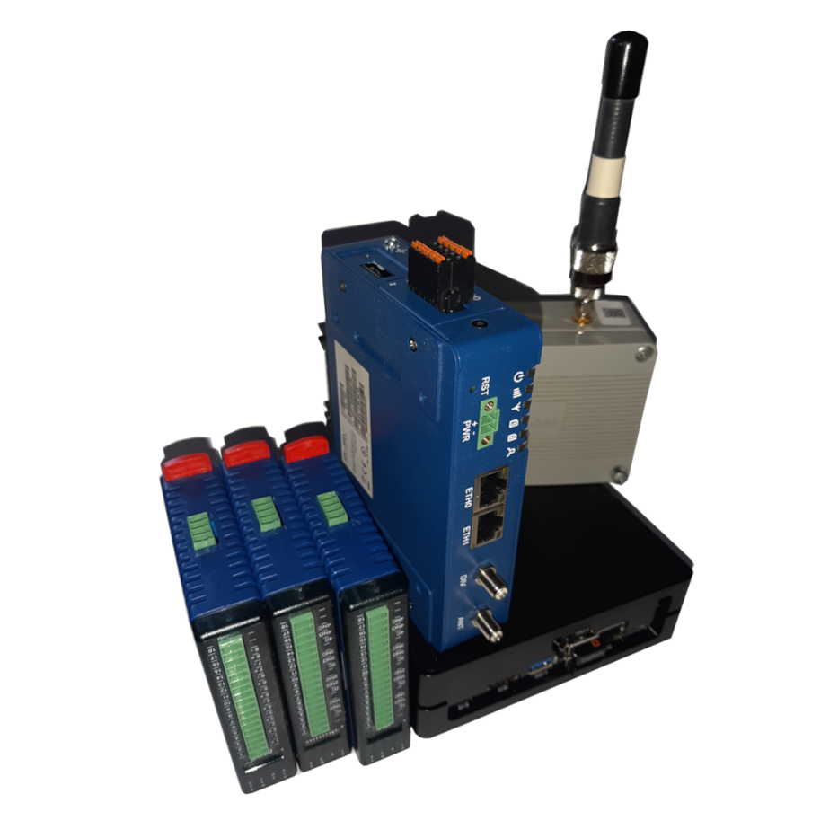

  <a class="news-card" href="/docs/Bios_Datasheet_FR_2025.pdf">
    
La régulation intelligente idéale en rénovation

    
    <h3>BIOS</h3>
    
Building Intelligent Operating System

    <ul class="icon-list">
      <li class="circle-check">
        Zéro refonte : s'installe sur l'existant. Un PC portable de seconde main peut faire l'affaire.
      </li>
      <li class="wrench">
        Si vous n'avez rien ou qu'il faut compléter votre dispositif, nous apportons nos propres modules.
      </li>
      <li class="euro">
        Coût maîtrisé : investissement 10x inférieur à une GTB.
      </li>
    </ul>
  </a>

