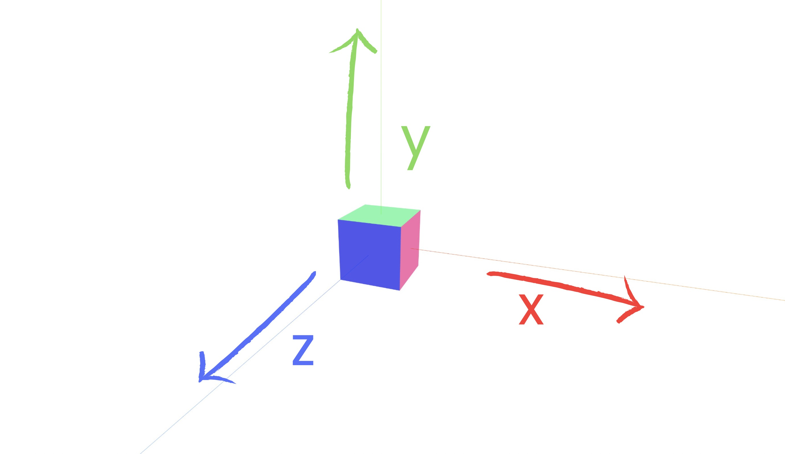

`<collada-scene-editor>`

Provides a live HTML editor for the scene declarations of a target
`<collada-viewer>`. The editor and viewer are independent elements; the
`target` attribute references the viewer's standard HTML `id`. The preview is
updated 350 ms after the last edit.

```html
<div class="scene-workspace">
  <collada-scene-editor target="scene-1"></collada-scene-editor>

  <collada-viewer id="scene-1" axes="5">
    <collada-object file="pump" position="0 0 0"></collada-object>
    <pipe points="0 0 0; 2 0 0" radius="0.1"></pipe>
    <wall position="0 0 0" width="5" height="2" depth="0.15"></wall>
  </collada-viewer>
</div>
```

- Edit the `<collada-object>`, `<pipe>` and `<wall>` declarations in the text area.
- Set `target` to the `id` of the viewer to edit; do not include a leading `#`.
- The editor waits if the target viewer has not yet been added to the document.
- Valid changes are applied to the target viewer without replacing unchanged source elements.
- Invalid or incomplete declarations are reported and leave the last valid scene visible.
- **Reset** restores the declarations captured when the editor first connects to its target.
- Viewer-level attributes (camera, zoom, axes, etc.) remain on the original
  `<collada-viewer>` and are not edited in the text area.
- Only direct `collada-object`, `pipe` and `wall` declarations are accepted.


`<collada-object>`

attribut | description
--|--
file | nom du fichier sans extension .dae
position | coordonnées X,Y,Z de l'origine du modèle COLLADA
rotation | angles en degrés autour des axes X Y Z
scale | un facteur unique ou trois facteurs X Y Z, tous entre 0 et 1  ("0.8" pour mettre à 80%)
hide-lines | masque les arêtes si attribut présent (pas de valeur à spécifier)

`<collada-viewer>`

attribut | description
--|--
zoom | facteur de zoom sur desktop (par exemple "150%")
zoom-mobile | facteur de zoom sur mobile
axes | longueur des axes. Si cet attribut n'est pas présent, les axes ne sont pas affichés
camera-rotation | angles en degrés définissant l'orientation initiale de la caméra
report-mouse-position | affiche les coordonnées X, Y, Z du point situé sous la souris



`<pipe>`

attribut | description
--|--
points | succession de points 3D séparés par des points-virgules, chaque point étant défini par X Y Z
radius | rayon du tuyau (default: 0.1)
color | couleur au format hexadécimal (default: #808080)
style | `smooth` (courbe fluide, default) ou `industrial` (segments droits et coudes arrondis)
closed | ferme les deux extrémités du tuyau (attribut booléen, activé par sa présence)

`<wall>`

attribut | description
--|--
position | coordonnées du point de coordonnées X,Y,Z minimales
width | largeur (suivant X)
height | hauteur (suivant Y)
depth | profondeur (suivant Z)
opacity | entre 0 et 1 (default: 1)
